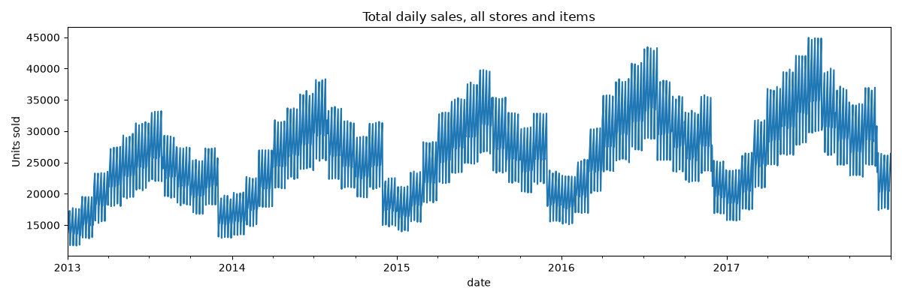
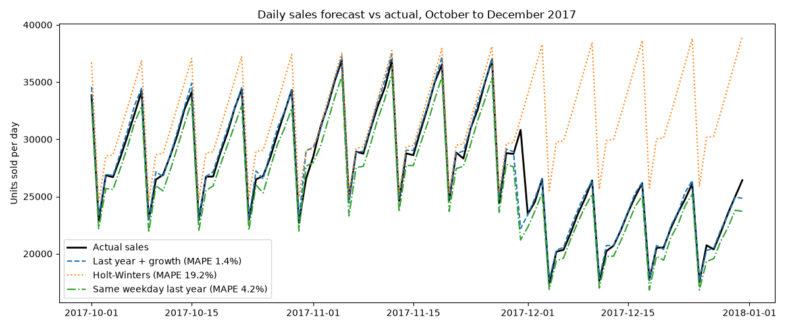

# Demand Forecasting and Reorder Points

Forecasting daily retail demand in Python and turning the forecast into an inventory decision: how much safety stock to hold and when to reorder.

Part of my supply chain analytics portfolio. The lead time used here comes from my [vendor performance data warehouse](https://github.com/DhanushRathnashekar/vendor-performance-warehouse).

## Data

Kaggle [Store Item Demand Forecasting Challenge](https://www.kaggle.com/competitions/demand-forecasting-kernels-only): daily unit sales for 50 items across 10 stores, January 2013 to December 2017. That is 913,000 rows, with one row for every store, item and day and no gaps.

The data is not included in this repository (it is subject to the competition rules). To run the scripts, download `train.csv` and place it in a folder named `Data`.

## Patterns found

- **Trend:** total units grew every year, from 7.94 million in 2013 to 10.73 million in 2017 (about 35%), but growth slowed from +15.0% (2014) to +3.6% (2017).
- **Yearly seasonality:** sales start low in January, peak mid-year and dip at year end, in the same shape every year.
- **Weekly seasonality:** Monday is the lowest day (41.4 units per store and item on average) and Sunday the highest (62.1), about 50% more.

## Forecast comparison

The last 92 days (October to December 2017) were held back as a test period. Each method was trained only on data up to September 30, 2017.

| Method | MAE (units/day) | MAPE | Pattern of errors |
|---|---|---|---|
| Same weekday last year | 1,152 | 4.2% | Too low almost every day (ignores growth) |
| **Same weekday last year + growth factor** | **403** | **1.4%** | **Small, in both directions** |
| Holt-Winters (trend + weekly seasonality) | 4,543 | 19.2% | Too high every day (misses the year-end dip) |

The simple growth-adjusted method won because copying last year carries the yearly seasonality, and the growth factor (1.048, measured from training data only) corrects the trend. Holt-Winters, set up with weekly seasonality only, kept forecasting growth into the December dip.

## From forecast to reorder point

For one product at one location (store 1, item 1), with a 95% service level (z = 1.65):

| Input or result | Value |
|---|---|
| Average forecast | 20.7 units/day |
| Typical daily forecast miss (standard deviation) | 6.6 units |
| Lead time | 7.62 days |
| Expected demand during lead time | 158 units |
| Safety stock = 1.65 × 6.6 × √7.62 | 30 units |
| **Reorder point** | **188 units** |

Sensitivity to lead time: 3 days gives 81 units, 7.62 days gives 188 units and 14 days gives 330 units.

The total forecast misses by 1.4%, but a single item at a single store misses by about 30% of its daily volume. Forecasts are more accurate at higher levels of aggregation, which is why safety stock is set per item and location.

## Limitations

- The 7.62-day lead time is borrowed from a different dataset (the vendor warehouse project) as an illustrative assumption. In practice it would come from the supplier's actual delivery history (for example goods receipt date minus PO date in the ERP).
- The safety stock formula assumes a fixed lead time. Variation in delivery time would require additional safety stock.
- The reorder point is shown for one store and item, as a worked example of the method.
- The "same weekday last year" method aligns weekdays, not calendar dates, so month boundaries shift by a day or two (the largest miss is around November 30).

## How to run

1. Download `train.csv` from the Kaggle link above into a folder named `Data`.
2. Create a virtual environment and install the libraries:
   `python -m venv .venv` then `.venv\Scripts\python.exe -m pip install -r requirements.txt`
3. Run the scripts in order, from `01_explore.py` to `09_reorder_point.py`.

## Files

- `01_explore.py` to `09_reorder_point.py`: the analysis, one step per script
- `chart_daily_sales.png`, `chart_forecast_comparison.png`: charts
- `requirements.txt`: library versions